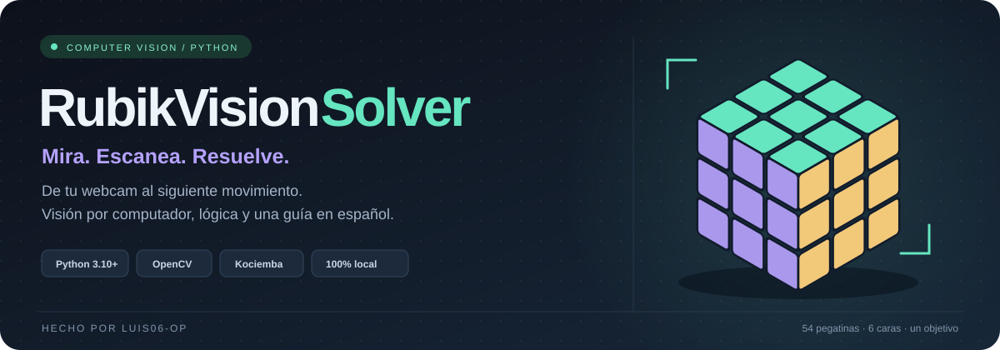
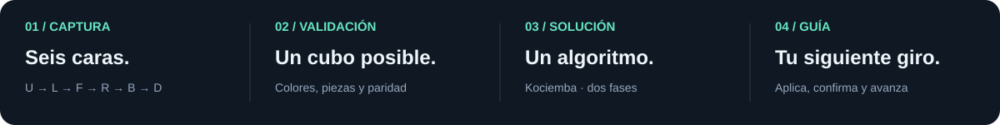
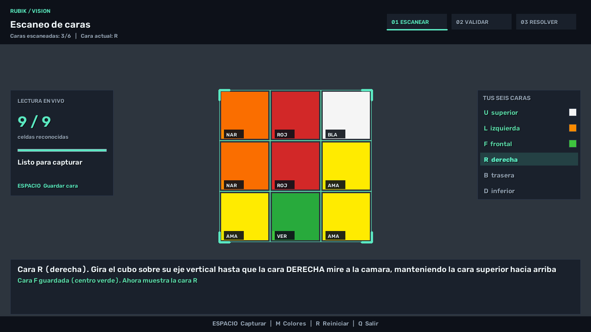
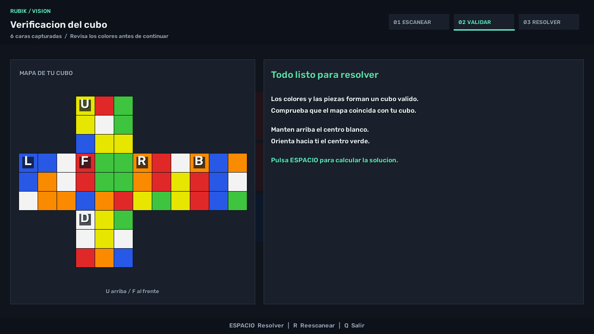
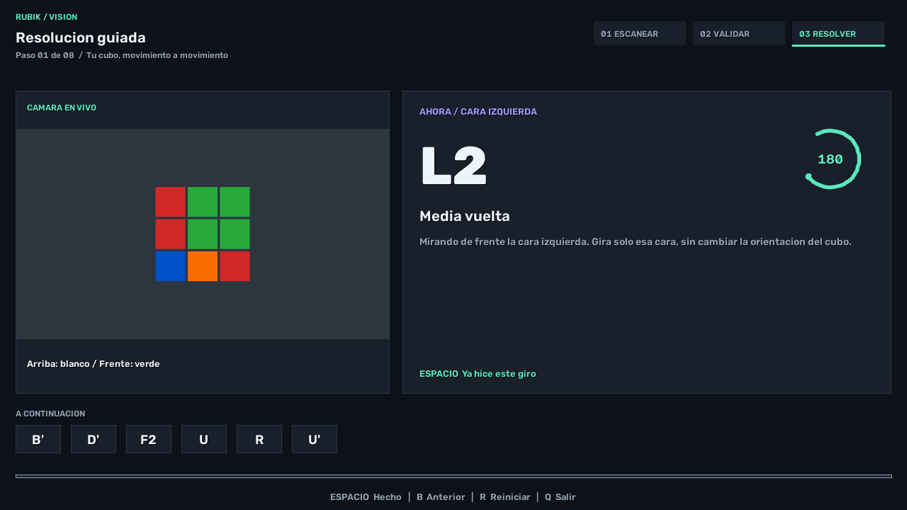
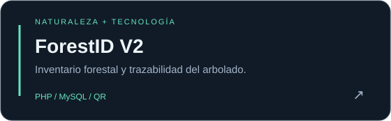
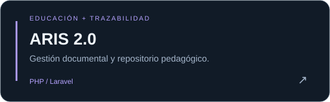
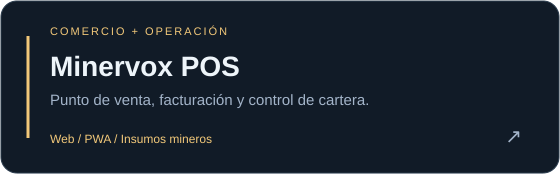
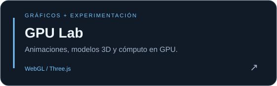

<p align="center">
  
</p>

<p align="center">
  <a href="https://www.python.org/"></a>
  <a href="https://opencv.org/"></a>
  <a href="LICENSE"></a>
  <a href="https://github.com/luis06-op"></a>
</p>

<p align="center">
  <a href="#vista-previa">Vista previa</a> ·
  <a href="#instalación">Instalación</a> ·
  <a href="#uso">Uso</a> ·
  <a href="#rendimiento">Rendimiento</a> ·
  <a href="docs/user_guide.md">Guía completa</a> ·
  <a href="#más-proyectos-de-luis06-op">Mis proyectos</a>
</p>

# RubikVisionSolver

### Tu webcam. Tu cubo. Tu siguiente movimiento.

Aplicación de escritorio que **escanea un cubo de Rubik con la webcam, comprueba
que el estado sea físicamente resoluble, calcula la solución con el algoritmo de
Kociemba y guía al usuario movimiento a movimiento** sobre el vídeo en directo.
La interfaz está en español y no requiere ningún montaje de hardware: basta un
cubo estándar y una cámara.

El programa no intenta adivinar la posición del cubo: muestra una cuadrícula de
3×3 en el centro de la imagen y el usuario coloca cada cara dentro de ella. Esto
permite controlar el encuadre y usar cámaras y luces domésticas.



## Vista previa

**Una interfaz que deja ver lo importante.** Encuadre limpio, lectura de las
nueve celdas, orientación de referencia y una instrucción por movimiento.

<table>
  <tr>
    <td width="50%"><strong>01 · Escanea con confianza</strong><br /><br /></td>
    <td width="50%"><strong>02 · Comprueba tu cubo</strong><br /><br /></td>
  </tr>
  <tr>
    <td colspan="2"><strong>03 · Un giro a la vez</strong><br /><br /></td>
  </tr>
</table>

> Capturas del renderizador real con un cubo **sintético**; no son fotografías de
> una webcam. Puedes regenerarlas sin cámara con `python -m scripts.preview`.

---

## Características

- Escaneo guiado de las seis caras en un orden que mantiene siempre la cara
  superior hacia arriba.
- Detección de color en HSV con votación por píxeles, filtro de mediana y
  umbral de confianza; tolera brillos, sombras suaves y ruido de la cámara.
- Validación completa antes de resolver:
  - nueve pegatinas de cada color;
  - seis centros distintos;
  - esquinas y aristas que existen en un cubo real;
  - suma de giros de esquina múltiplo de 3;
  - suma de volteos de arista par;
  - paridad de la permutación.
- Solución con [`kociemba`](https://pypi.org/project/kociemba/), el
  solucionador de dos fases de Herbert Kociemba.
- Guía paso a paso con notación de Singmaster e instrucciones en español
  («Gira la cara derecha 90 grados en sentido horario…»), con navegación hacia
  delante y hacia atrás.
- Diagnóstico de iluminación en pantalla y vista de depuración de la máscara
  HSV para calibrar colores.
- Interfaz azul oscuro con acentos menta/violeta, cámara visible durante la guía,
  indicadores de lectura, flechas de giro y próximos movimientos.
- Código tipado, sin dependencias de interfaz en la lógica y con máquina de
  estados comprobable sin cámara.

---

## Arquitectura

```
                 fotograma BGR
   ┌──────────┐ ───────────────► ┌────────────┐
   │ camera   │                  │ detector   │  HSV + votación por celda
   └──────────┘                  └─────┬──────┘
                                       │ 9 muestras por cara
                                       ▼
   ┌────────────┐   acciones   ┌──────────────┐   pantalla   ┌──────────────┐
   │ teclado    │ ───────────► │ main         │ ───────────► │ ui_renderer  │
   └────────────┘              │ (máquina de  │              └──────────────┘
                               │  estados)    │
                               └──┬────────┬──┘
                                  │        │
                       modelo ────┘        └──── solución
                     ┌────────────────┐   ┌──────────────┐
                     │ cube_state     │   │ solver       │
                     │ modelo+validez │   │ Kociemba     │
                     └────────────────┘   └──────────────┘
```

| Módulo | Responsabilidad |
|---|---|
| `src/camera.py` | Abre `cv2.VideoCapture`, configura resolución/FPS, reintenta lecturas, aplica la ROI y libera el dispositivo de forma idempotente. |
| `src/detector.py` | Clasifica las nueve celdas de la cuadrícula en HSV y mide la iluminación. No dibuja nada. |
| `src/cube_state.py` | Modelo de las 54 pegatinas, movimientos, serialización a la cadena de Kociemba y validador de estados imposibles. |
| `src/solver.py` | Adapta `kociemba`, valida la entrada y convierte la respuesta en movimientos tipados con descripciones en español. |
| `src/ui_renderer.py` | Dibuja todas las pantallas (escaneo, validación, espera, guía, fin y error) y traduce teclas a acciones. |
| `src/main.py` | Máquina de estados, orquestación, CLI y bucle de vídeo. `Application.process()` es el punto de entrada sin ventana, usado por las pruebas. |

Las dependencias apuntan siempre hacia el modelo: el detector y el renderizador
no se conocen entre sí, y `cube_state`/`solver` no importan OpenCV. Esto permite
probar la lógica completa con fotogramas sintéticos.

### Máquina de estados

| Estado | Qué ocurre | Salida |
|---|---|---|
| `SCANNING` | Se pide una cara por vez (`U → L → F → R → B → D`). ESPACIO captura la cuadrícula. | Al capturar la sexta cara. |
| `VALIDATING` | Se muestra el desarrollo plano y el informe de validez. ESPACIO confirma. | A `SOLVING` si el cubo es válido. |
| `SOLVING` | Se anuncia la espera en un fotograma y se calcula en el siguiente. | A `GUIDING` o `FINISHED`. |
| `GUIDING` | Se muestra el movimiento actual y la instrucción física. | Al superar el último movimiento. |
| `FINISHED` | La secuencia está completada; comprueba tu cubo. `R` inicia otro escaneo. | — |
| `ERROR` | Fallo de cámara o de imagen; `R` reintenta. | — |

---

## Instalación

Requisitos:

- Python **3.10 o superior** (probado con 3.14).
- Una webcam accesible por OpenCV.
- Entorno gráfico para la ventana de vídeo (escritorio local o escritorio
  remoto con reenvío X11/Wayland). En un servidor sin pantalla la aplicación no
  puede mostrar la ventana.

```bash
# Clona el repositorio o descarga y descomprime el ZIP desde GitHub.
cd RubikVisionSolver

python3 -m venv .venv
source .venv/bin/activate        # Windows: .venv\Scripts\activate

pip install --upgrade pip
pip install -r requirements.txt
```

`requirements.txt` usa marcadores de versión porque NumPy y OpenCV publican
ruedas binarias distintas según la versión de Python. Instala siempre
`opencv-python` (con GUI), **nunca** `opencv-python-headless`: esta última no
puede abrir la ventana de vídeo.

Comprobación rápida de la cámara:

```bash
python -m src.main --probe-camera
```

---

## Uso

```bash
python -m src.main
```

Al arrancar se abre una ventana con la imagen de la cámara y una cuadrícula 3×3.
La aplicación pide las caras en este orden:

| Orden | Cara | Cómo colocarla |
|---|---|---|
| 1 | `U` superior | Inclina el cubo hacia ti hasta que la cara superior mire a la cámara; la frontal queda abajo. |
| 2 | `L` izquierda | Gira el cubo sobre su eje vertical hasta que la cara izquierda mire a la cámara, con la superior arriba. |
| 3 | `F` frontal | Coloca la cara frontal mirando a la cámara, con la superior arriba. |
| 4 | `R` derecha | Gira el cubo sobre su eje vertical hasta que la cara derecha mire a la cámara, con la superior arriba. |
| 5 | `B` trasera | Gira el cubo 180° hasta que la cara trasera mire a la cámara, con la superior arriba. |
| 6 | `D` inferior | Inclina el cubo hacia atrás hasta que la cara inferior mire a la cámara; la frontal queda arriba. |

En cada cara, centra el cubo para que ocupe la cuadrícula y pulsa **ESPACIO**.
Si alguna celda no se reconoce, la aplicación lo indica y no avanza: ajusta la
luz o el encuadre y vuelve a intentarlo. Al terminar las seis caras se muestra
el desarrollo plano; revísalo y pulsa ESPACIO para resolver.

La solución aparece como una secuencia de movimientos. Cada paso indica la cara
y el sentido del giro; aplica el movimiento en el cubo y pulsa **ESPACIO** para
marcarlo como hecho y pasar al siguiente. `ENTER`, `N` y `→` avanzan del mismo
modo fuera del escaneo, y `B` retrocede en las instrucciones. Retroceder no
deshace físicamente un giro: corrígelo en el cubo antes de repetir el paso.

### Teclas

| Tecla | Acción |
|---|---|
| `ESPACIO` | Capturar la cara actual, confirmar el desarrollo o avanzar de movimiento. |
| `ENTER`, `N`, `→` | Confirmar / avanzar (equivalente a ESPACIO fuera del escaneo). |
| `B`, `←` | Movimiento anterior durante la guía. |
| `R` | Reiniciar el escaneo; en la pantalla de error, reintentar la cámara. |
| `M` | Mostrar u ocultar la máscara HSV de depuración. |
| `Q`, `ESC` | Salir. |

### Opciones de línea de comandos

```bash
python -m src.main \
  --camera 1 \
  --width 1920 --height 1080 --fps 30 \
  --roi 0.1,0.1,0.8,0.8 \
  --max-depth 24 \
  --debug-mask
```

| Opción | Valor por defecto | Descripción |
|---|---|---|
| `--camera` | `0` | Índice del dispositivo de vídeo. |
| `--width`, `--height` | `1280`, `720` | Resolución solicitada. |
| `--fps` | `30` | Fotogramas por segundo solicitados. |
| `--roi X,Y,W,H` | fotograma completo | Región de interés en fracciones (0–1). Útil para recortar la zona donde se coloca el cubo. |
| `--max-depth` | `24` | Profundidad de la primera fase de Kociemba (10–30). Más profundidad explora soluciones más cortas a costa de tiempo. |
| `--debug-mask` | desactivado | Arranca con la máscara HSV visible. |
| `--probe-camera` | — | Abre la cámara, imprime la resolución real y sale. |

---

## Iluminación y calibración

La detección de color es el punto más sensible del sistema. Recomendaciones:

- Usa **luz blanca y difusa** (lámpara de techo o ventana sin sol directo).
  Evita focos que produzcan reflejos especulares sobre las pegatinas.
- Coloca el cubo sobre una superficie neutra (mesa clara u oscura, sin colores
  intensos) y evita fondos de color similar a las pegatinas.
- Llena la cuadrícula: el detector muestrea el **46 % del lado menor** del
  fotograma. Si el cubo es pequeño, acerca la cámara o usa `--roi` para
  recortar.
- Mantén el cubo perpendicular a la cámara; inclinaciones fuertes deforman las
  celdas y mezclan colores en los bordes.
- Deja que el balance de blancos automático se estabilice unos segundos tras
  encender la lámpara.

La aplicación avisa si la zona está demasiado oscura, oscura o sobreexpuesta.
La tecla `M` (o `--debug-mask`) pinta cada píxel con el color detectado: si una
pegatina aparece en negro, su tono queda fuera de los rangos configurados.

Rangos HSV por defecto (OpenCV: `H` 0–179, `S` y `V` 0–255):

| Color | H | S | V |
|---|---|---|---|
| Blanco | 0–179 | 0–70 | 140–255 |
| Amarillo | 19–35 | 90–255 | 120–255 |
| Rojo | 0–6 y 173–179 | 110–255 | 80–255 |
| Naranja | 7–18 | 110–255 | 100–255 |
| Azul | 95–130 | 100–255 | 70–255 |
| Verde | 40–88 | 70–255 | 60–255 |

Para calibrar, edita `DEFAULT_COLOR_RANGES` en `src/detector.py` o construye
`ColorDetector(ranges=...)` con una copia modificada. Cada celda se clasifica
por la fracción de píxeles dentro de cada rango; se exige al menos un **35 %**
de confianza. Los empates entre colores próximos (rojo/naranja,
naranja/amarillo) se resuelven con la mediana de tono de la celda.

Consejos prácticos:

- Si el **rojo** se confunde con naranja, estrecha el límite superior del rojo
  o el inferior del naranja.
- Si el **amarillo** se confunde con blanco, sube el mínimo de saturación del
  amarillo.
- Si el **blanco** se confunde con colores claros, baja el máximo de saturación
  del blanco (70) o sube su mínimo de brillo (140).
- Si aparecen celdas vacías con luz correcta, baja `min_confidence` a 0.25–0.30.

---

## Pruebas y calidad

```bash
pip install -r requirements-dev.txt

pytest                 # suite completa, sin cámara ni ventana
ruff check .           # estilo y errores estáticos
mypy                   # tipado estricto de src/
```

La suite cubre el detector con fotogramas sintéticos, la geometría y los
invariantes del cubo, el adaptador de Kociemba, la captura con un dispositivo
simulado y el flujo completo de la máquina de estados, incluidos los caminos de
error.

## Rendimiento

El detector filtra y convierte a HSV **solo la cuadrícula y el margen necesario
para el filtro**, en lugar de procesar toda la imagen. La clasificación usa
máscaras de 8 bits sin conversiones booleanas intermedias. Las superficies y
medidas de texto de la UI se reutilizan mediante cachés limitadas.

El bucle descuenta el tiempo de captura y procesamiento de la espera entre
fotogramas. También conserva la captura original para que el dibujo de la
interfaz no contamine el siguiente análisis ni las pantallas de recuperación.

```bash
python -m scripts.benchmark             # mediana y p95 a 480p, 720p y 1080p
python -m scripts.benchmark --frames 300
python -m scripts.preview              # exportar las siete pantallas sin webcam
```

El benchmark usa imágenes sintéticas, diez iteraciones de calentamiento y un
hilo de OpenCV. Mide procesamiento; **no mide los FPS de la webcam**. Consulta
[las mediciones y el método](docs/performance.md).

---

## Estructura del proyecto

```
RubikVisionSolver/
├── src/
│   ├── __init__.py
│   ├── main.py            # máquina de estados, CLI y bucle de vídeo
│   ├── camera.py          # captura y ROI
│   ├── detector.py        # clasificación HSV de las nueve celdas
│   ├── cube_state.py      # modelo, movimientos y validador
│   ├── solver.py          # adaptador de Kociemba
│   └── ui_renderer.py     # dibujo de todas las pantallas
├── tests/
│   ├── test_application.py
│   ├── test_camera.py
│   ├── test_cube_state.py
│   ├── test_detector.py
│   ├── test_optimizations.py
│   ├── test_ui_renderer.py
│   └── test_solver.py
├── scripts/
│   ├── benchmark.py       # medición reproducible sin cámara
│   └── preview.py         # exportación de capturas sintéticas
├── docs/
│   ├── assets/           # banner, tarjetas SVG y capturas de la interfaz
│   ├── performance.md    # mediciones y alcance del benchmark
│   └── user_guide.md      # guía paso a paso para el usuario final
├── requirements.txt
├── requirements-dev.txt
├── pyproject.toml         # configuración de ruff y mypy
├── pytest.ini
├── LICENSE
└── README.md
```

---

## Limitaciones

- El escaneo es **manual y cara a cara**; no se detecta la pose del cubo ni se
  corrige la perspectiva automáticamente.
- Se asume un cubo estándar de 3×3×3 con seis colores distintos y centros
  fijos. Los cubos con pegatinas de colores no estándar requieren recalibrar
  los rangos HSV.
- La cámara debe estar en color y con una exposición razonable; una webcam muy
  saturada o con viñeteado fuerte puede requerir ajustes.
- La solución de Kociemba no siempre es la más corta posible, pero sí correcta
  y normalmente alrededor de 20 movimientos.
- La ventana de vídeo necesita un entorno gráfico; la lógica y las pruebas
  funcionan sin él.
- La guía avanza por confirmación manual: no verifica por cámara que hayas
  ejecutado cada giro. Al terminar, comprueba las seis caras.

## Más proyectos de luis06-op

Una selección de mis proyectos públicos: gestión forestal, educación, comercio
y gráficos en tiempo real. Cada tarjeta abre su repositorio.

<table>
  <tr>
    <td width="50%"><a href="https://github.com/luis06-op/ForestID_V2"></a></td>
    <td width="50%"><a href="https://github.com/luis06-op/ARIS-V2"></a></td>
  </tr>
  <tr>
    <td><a href="https://github.com/luis06-op/minervox-pos"></a></td>
    <td><a href="https://github.com/luis06-op/gpu-lab"></a></td>
  </tr>
</table>

<p align="center"><a href="https://github.com/luis06-op?tab=repositories">Ver todos mis repositorios →</a></p>

## Licencia

MIT. Consulta [LICENSE](LICENSE).

<p align="center"><sub>Diseñado para aprender, experimentar y resolver · <a href="https://github.com/luis06-op">luis06-op</a></sub></p>
